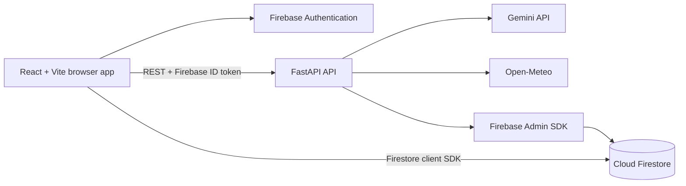

# Vastrakalp architecture

The repository has a Python-only backend and a React/TypeScript browser frontend. Backend hosting can be serverless on Vercel or containerized on Google Cloud Run.

## Request and data flow

The browser obtains Firebase ID tokens and sends them as bearer tokens for protected API operations. The backend verifies tokens with Firebase Admin; it does not accept unsigned token payloads or issue a development identity. Firebase client configuration is public browser configuration. Gemini credentials and any Firebase Admin service-account credential remain server-side.

Weather data is retrieved from Open-Meteo. Garment analysis and outfit recommendations use the Gemini integration when configured and the backend's deterministic fallback where implemented.

## Hosting topology

### Vercel

`vercel.json` sends `/api/*` to `api/index.py`, which exports `backend.main:app` for the Python ASGI runtime. Other paths serve the built Vite application. The Vercel function requires the root `requirements.txt` and the included Python `backend/` package. Set Firebase Admin credentials server-side using the protected `FIREBASE_SERVICE_ACCOUNT_JSON` environment variable.

### Cloud Run

`Dockerfile.backend` builds and runs only the Python API. The container listens on the platform-provided `PORT` (defaulting to `8080` for local container use). Cloud Run should use its attached service identity and Application Default Credentials for Firestore rather than a downloaded service-account key. The Vite frontend can remain on Vercel and call the Cloud Run service using the public `VITE_API_URL` setting.

When frontend and API origins differ, configure `ALLOWED_ORIGINS` with the exact frontend origin. Same-origin Vercel routing does not require browser CORS.

## Runtime configuration

| Setting | Consumer | Handling |
| --- | --- | --- |
| `GEMINI_API_KEY` | Python API | Server-side secret; configure through Vercel environment settings or Cloud Run Secret Manager. |
| `FIREBASE_PROJECT_ID` | Python API | Project ID for Firebase Admin initialization. |
| `FIREBASE_DATABASE_ID` | Python API and browser build | Match the configured browser database; set `(default)` only when using the default Firestore database. |
| `FIREBASE_SERVICE_ACCOUNT_JSON` | Vercel Python function | Protected server-side service-account JSON value for Firebase Admin. |
| `GOOGLE_APPLICATION_CREDENTIALS` | Local Python API | Optional local credential-file path; do not commit the file. |
| `ALLOWED_ORIGINS` | Python API | Comma-separated exact origins for cross-origin deployments. |
| `PORT` | Python API | Local default is `8000`; Cloud Run supplies the runtime port. |
| `VITE_API_URL` | Vite browser build | Empty for same-origin Vercel; Cloud Run URL when hosted separately. |
| `VITE_FIREBASE_*` | Vite browser build | Public Firebase Web SDK configuration; falls back to `firebase-applet-config.json`. |

Never put server credentials in `VITE_*` variables. Firebase Web API keys and app IDs are public identifiers, not replacements for Firebase Authentication or Firestore security rules.
